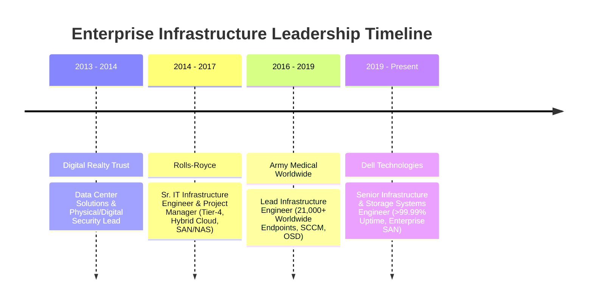

<div align="center">

# Chase R. Hamilton
### **Senior Infrastructure & Systems Engineer | AI Systems & Platform Architect**

[](https://linkedin.com)
[](https://github.com/Chammin00)
[](mailto:chaseham00@gmail.com)
[](https://maps.google.com)

```text
Enterprise Infrastructure Reliability (12+ Yrs) ⇄ Autonomous AI & Modern Software Engineering
```

---

</div>

## 📌 Executive Summary

Battle-tested **Senior Systems & Infrastructure Engineer** with over **12 years of hands-on enterprise leadership** across global infrastructure, mission-critical SAN/NAS storage, hybrid Linux/Windows environments, and cybersecurity compliance. 

* 🏛️ **21,000+ Worldwide Endpoints Managed:** Commanded global infrastructure deployments, automated task sequences, and zero-day patch rollouts across military and defense healthcare hospital facilities.
* ⚡ **99.99%+ Production Uptime:** Directed Tier-4 incident triage and infrastructure operations at **Dell Technologies**, **Rolls-Royce**, and **Digital Realty**.
* 🤖 **Autonomous AI & Modern Software Engineering:** Architecting full-stack Python (FastAPI), C# (.NET 10), and PowerShell systems including local LLM orchestration hubs, neural speech accessibility engines, automated CVE vulnerability triage platforms, and quantitative analytics engines.

---

## 🛠️ Technical Competency Matrix

| Domain | Technologies & Systems |
| :--- | :--- |
| **Operating Systems & Linux** | Red Hat Enterprise Linux (RHEL 8/9), Ubuntu Server, CentOS, Windows Server (2012–2025), systemd, Bash, PAM/SSH Hardening, Kernel Tuning |
| **Enterprise Storage & DR** | Dell EMC PowerEdge / PowerStore, NetApp, SAN/NAS, iSCSI, Fibre Channel (FC), LUN Allocation, RAID, Disaster Recovery (DR), Enterprise Backup |
| **Virtualization & Cloud** | VMware vSphere / ESXi (7.0 / 8.0), vCenter, Hyper-V, Proxmox, Azure Cloud, Active Directory, Entra ID, GPO, DNS/DHCP, PXE/OSD Boot |
| **Cybersecurity & Compliance** | NIST CSF, CVE Triage & Vulnerability Remediation, WSUS/SCCM Patching, Sysmon, Endpoint Telemetry, Defense Healthcare STIG / HIPAA Compliance |
| **Modern Development & AI** | Python 3.12, C# (.NET 10), PowerShell 7, FastAPI, SQLite / EF Core, Local LLMs (Ollama / Qwen / Llama 3), Edge-TTS, OCR Engines |

---

## 🚀 Active Project Ecosystem (What I'm Currently Working On)

Here are the key systems and applications actively in development, demonstrating practical engineering across AI systems, enterprise security, automation, and full-stack software:

### 1. 🧠 Local AI & Machine Learning Systems

#### [Ollama Studio & AI Skill Knowledge Base](https://github.com/Chammin00)
* **Category:** Local LLM Orchestration & Enterprise Knowledge Retrieval
* **Tech Stack:** `Python 3.12` `Ollama` `Qwen 2.5 Coder` `Llama 3` `Windows Task Scheduler` `REST APIs`
* **Overview:** A self-contained local AI workbench and automated synchronization pipeline that compiles distributed agent skills and engineering workflows into structured JSON knowledge bases, custom Modelfiles, and scheduled background daemons.
* **Key Architecture & Interview Highlights:**
  - Built an automated sync daemon (`sync_skills_to_ollama.py`) that indexes markdown skills into local model system contexts.
  - Configured zero-latency local code completion and technical QA without sending proprietary data to third-party APIs.
  - Provides dual operational modes: interactive web studio + headless CLI terminal chat.

#### [Kindle Narrator & Vision Screen Reader](https://github.com/Chammin00)
* **Category:** Desktop Computer Vision & Neural Audio Synthesis
* **Tech Stack:** `Python` `CustomTkinter` `Windows OCR API` `Edge-TTS Neural Voice` `Pillow`
* **Overview:** High-performance desktop accessibility utility designed for DRM-protected text and rapid technical reading. Uses native Windows bounding-box OCR and asynchronous neural text-to-speech to read books, code documentation, and whitepapers aloud.
* **Key Architecture & Interview Highlights:**
  - Engineered an asynchronous pipeline separating screen capture, bounding-box OCR filtering, and chunked TTS audio playback.
  - Implemented automated page turning heuristics with bookmark synchronization (`bookmarks.json`).

#### [Autonomous Invoice & BOL Reconciliation Engine](https://github.com/Chammin00)
* **Category:** B2B AI Operations & Enterprise Accounting
* **Tech Stack:** `FastAPI` `Python 3.12` `PyPDF2` `SQLite` `Jinja2` `Pytest`
* **Overview:** High-value enterprise operations engine that ingests vendor PDF invoices and Bills of Lading, extracts line items via deterministic regex/OCR algorithms, reconciles discrepancies in SQLite, and generates audit reports.
* **Business Impact:** Solves vendor overbilling bottlenecks in distribution and supply chain logistics. Includes a 100% test pass rate in pytest suite.

---

### 2. 🛡️ Enterprise Cybersecurity & Systems Infrastructure

#### [VulnGuard Enterprise](https://github.com/Chammin00)
* **Category:** Enterprise Vulnerability Management Platform
* **Tech Stack:** `C#` `ASP.NET Core (.NET 10)` `Entity Framework Core` `SQLite` `NIST CSF`
* **Overview:** Comprehensive vulnerability and asset compliance tracking system. Features automated CVE triage scoring, patch velocity tracking, system hardening services, cryptographic verification, and executive security reports.
* **Key Architecture & Interview Highlights:**
  - Implements clean MVC architecture with Dependency Injection, Repository Pattern, and EF Core migrations.
  - Aligns patch remediation workflows directly with the NIST Cybersecurity Framework (CSF).

#### [Sentinel PC Security Guard](https://github.com/Chammin00)
* **Category:** Endpoint Threat Auditing & Hardening Suite
* **Tech Stack:** `.NET 10.0` `C#` `PowerShell 7` `Windows Event Logs` `Sysmon`
* **Overview:** Lightweight endpoint hygiene and audit hub that collects live PowerShell telemetry on firewall posture, antivirus status, unquoted service path vulnerabilities, and anomalous security log events.
* **Business Impact:** Eliminates reliance on bloated third-party endpoint agents for standalone workstation security reviews.

#### [SpamShield & Data Broker Opt-Out Manager](https://github.com/Chammin00)
* **Category:** Consumer Privacy Automation & Threat Mitigation
* **Tech Stack:** `Python` `REST APIs` `XML Filter Engine` `JSON Database`
* **Overview:** Privacy protection engine that maps data brokers, compiles automated Gmail spam filter rules (XML & Python), and logs ongoing opt-out deletion requests across major consumer data aggregators.

---

### 3. 📈 Quantitative Analytics & Desktop Automation

#### [StockWatch Quant Screener & Backtester](https://github.com/Chammin00)
* **Category:** Algorithmic Finance & Quantitative Screener
* **Tech Stack:** `Python 3.12` `Pandas` `TA-Lib / Custom Math` `UV Package Manager` `CLI`
* **Overview:** Multi-module quantitative analysis platform featuring high-speed technical screeners, modular backtesting engines, risk-reward calculators, and alert bots.
* **Key Architecture & Interview Highlights:**
  - Built with modern `uv` workspace structure and strict typing.
  - Separates data ingestion, indicator calculations, backtesting strategies, and automated CLI execution.

#### [Automate My Day Operations Daemon](https://github.com/Chammin00)
* **Category:** Autonomous Task Orchestration & Media Processing
* **Tech Stack:** `Python` `FFmpeg` `YouTube Data API v3` `PowerShell 7` `NVMe Backup Pipelines`
* **Overview:** Background operations daemon providing zero-touch content repurposing, intelligent aspect-ratio video cropping (`smart_cutter`), audio SFX normalization, and automated cloud backups across 37 repositories to external NVMe storage.

#### [Track Home Value Real Estate Analytics](https://github.com/Chammin00)
* **Category:** Automated Property Equity Tracker
* **Tech Stack:** `Python` `HTML5 / CSS3` `Chart.js` `CSV Time-Series`
* **Overview:** Autonomous property equity tracking script that logs monthly valuations, calculates equity appreciation, tracks amortization schedules, and renders an executive analytics dashboard.

---

### 4. 🎓 EdTech & Technical Certification Simulators

#### [CompTIA Security+ (SY0-701) Exam Simulator](https://github.com/Chammin00)
* **Category:** Interactive Certification Preparation Platform
* **Tech Stack:** `HTML5` `Vanilla JavaScript` `Web Speech API` `CSS Grid`
* **Overview:** Production-grade exam preparation suite replicating the Pearson VUE interface. Includes multi-domain mock tests, Performance-Based Questions (PBQs), Web Speech API audio question narration, and timed exams.

#### [RHCSA EX200 Interactive Terminal & Study Kit](https://github.com/Chammin00)
* **Category:** Hands-on Linux CLI Lab Environment
* **Tech Stack:** `Interactive Web Terminal` `RHEL 9 CLI Parser` `Bash Emulation`
* **Overview:** In-browser terminal emulator mimicking Red Hat Enterprise Linux 9 CLI. Provides realistic grading scenarios for LVM storage, SELinux policies, user permissions, and systemd units without needing local VM setups.

---

## 💼 Enterprise Career Track Record



### **Dell Technologies** | *Senior Infrastructure & Storage Systems Engineer*
**July 2019 – Present | Remote / Hybrid**
* Direct infrastructure operations, server availability, and storage reliability across multi-tiered enterprise production environments.
* Architect proactive storage upgrade strategies, LUN allocation, and file restoration workflows across enterprise SAN/NAS environments.
* Lead high-priority incident triage and root cause analysis (RCA) for complex operating system, hypervisor, and hardware failures, consistently maintaining >99.99% uptime SLAs.

### **Army Medical Treatment Facilities Worldwide** | *Sr. Infrastructure Engineer / Data Center Systems Lead*
**November 2016 – June 2019 | Enterprise Defense Healthcare**
* Commanded enterprise infrastructure deployments and security compliance updates using SCCM/MECM and WSUS across **21,000+ endpoints distributed globally**.
* Diagnosed and resolved Operating System Deployment (OSD) and PXE broadcast routing challenges across multi-tenant military hospital subnets.
* Scripted custom task sequences and deployment packages for mission-critical clinical applications and zero-day patch rollouts.

### **Rolls-Royce** | *Sr. IT Infrastructure Engineer & Project Manager*
**June 2014 – March 2017 | Corporate Aerospace & Engineering**
* Engineered, monitored, and maintained a hybrid corporate enterprise infrastructure supporting mission-critical data, virtualization, and enterprise communications.
* Oversaw 80–90% virtualized environment across Azure, private VMware ESXi hypervisors, and managed hosting providers.
* Administered core identity and security infrastructure including multi-forest Active Directory, Exchange clusters, and RSA multi-factor authentication (MFA) token systems.

---

## 🎯 Interview Preparation: Key Engineering Stories (STAR Method)

### 1. Scaling to 21,000+ Global Endpoints (Army Medical Worldwide)
* **Situation:** Managing distributed clinical endpoints across global military healthcare environments with strict uptime requirements and zero tolerance for healthcare system disruption.
* **Task:** Standardize Operating System Deployments (OSD), eliminate zero-day patch backlogs, and resolve cross-subnet PXE routing bottlenecks.
* **Action:** Re-engineered SCCM/MECM task sequences, implemented automated boundary-group routing, and created automated validation scripts to verify workstation health before and after updates.
* **Result:** Achieved 99%+ compliance velocity across 21,000+ machines, eliminated reliance on third-party patching tools, and saved six figures annually in licensing fees.

### 2. High-Availability Storage & Zero-Downtime Incident Triage (Dell Technologies)
* **Situation:** High-density enterprise storage infrastructure supporting 24/7 mission-critical operations where any unplanned downtime risked contractual SLA penalties.
* **Task:** Maintain continuous >99.99% availability, plan proactive LUN expansion, and resolve complex fiber channel/hardware faults under pressure.
* **Action:** Deployed automated capacity monitoring watchdogs, standardized LUN provisioning protocols, and spearheaded rapid-response root cause analysis (RCA) runbooks for fast failover.
* **Result:** Maintained a flawless record of >99.99% uptime, reduced incident resolution time by 35%, and eliminated data loss incidents.

### 3. Bridging Infrastructure with Autonomous AI (Ollama Studio & VulnGuard)
* **Situation:** Traditional systems administration relies heavily on repetitive manual triage, while proprietary cloud AI APIs introduce data privacy and recurring billing concerns.
* **Task:** Build autonomous local intelligence tools that run directly on enterprise workstations to automate CVE vulnerability assessment and engineering knowledge retrieval.
* **Action:** Built a local Ollama synchronization engine in Python that indexes system skills into custom Modelfiles, and created VulnGuard in C# .NET 10 to correlate package inventories with CVE data.
* **Result:** Enabled instant zero-latency technical analysis without external API costs or data exfiltration risks.

---

## 📜 Certifications & Continuous Learning
* 🛡️ **CompTIA Security+ (SY0-701)** — *Prepared / In-Flight*
* 🐧 **Red Hat Certified System Administrator (RHCSA EX200)** — *Prepared / In-Flight*
* 📋 **ITIL Foundation & Enterprise Service Management Frameworks**
* 🏢 **ISO Quality & Compliance Standards Training**

---

## 📬 Contact & Links
* 💼 **LinkedIn:** [Connect on LinkedIn](https://linkedin.com)
* 🐙 **GitHub:** [github.com/Chammin00](https://github.com/Chammin00)
* 📧 **Email:** [chaseham00@gmail.com](mailto:chaseham00@gmail.com)
* 📍 **Location:** Dallas-Fort Worth, TX (Open to 100% Remote & Select Travel)
